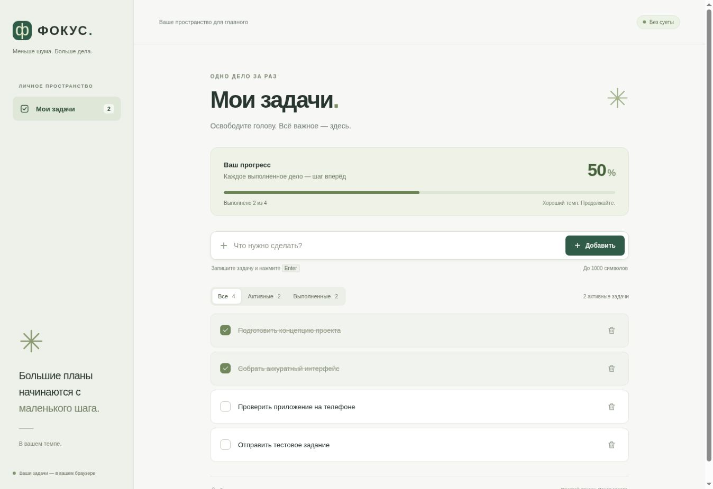
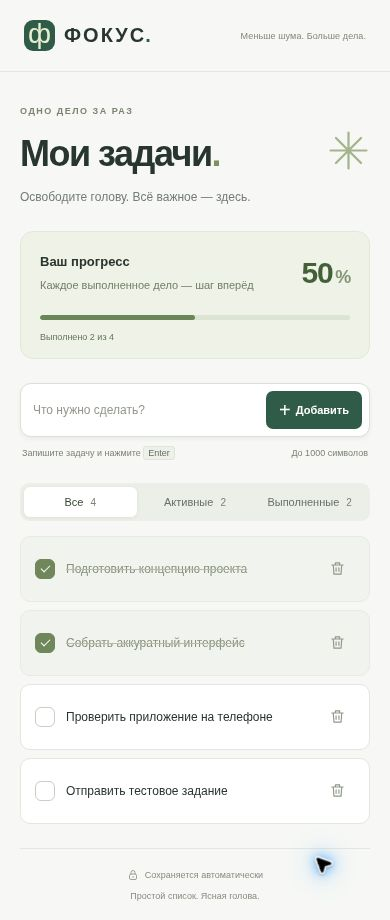

# ФОКУС — простой список задач

Минималистичное приложение для повседневных дел. Запишите задачу, отметьте готовое и сосредоточьтесь на следующем шаге. Без регистрации, сервера и зависимостей.

Тестовое задание на позицию Vibe Coder в The Digital.

## Демонстрация

🌐 [Открыть приложение «ФОКУС»](https://apestalina-byte.github.io/focus-todo/)

💻 [Исходный код на GitHub](https://github.com/apestalina-byte/focus-todo)



<details>
<summary>Мобильная версия</summary>



</details>

Скриншоты показывают демонстрационные задачи. При первом запуске у нового пользователя список пуст.

## Возможности

- Добавление кнопкой или клавишей Enter.
- Проверка пустого ввода и нормализация повторных пробелов.
- Задачи длиной до 1000 символов с переносом длинных строк.
- Отметка выполнения и возврат в активное состояние.
- Удаление из списка и сохранённых данных.
- Автоматическое сохранение текста, статуса и порядка задач.
- Фильтры «Все», «Активные», «Выполненные» со счётчиками.
- Индикатор общего прогресса и отдельные пустые состояния.
- Адаптивная вёрстка и ненавязчивые анимации.
- Работа с клавиатурой, видимый фокус, доступные названия кнопок и объявления изменений для скринридеров.
- Поддержка системной настройки уменьшения движения.
- Обновление списка при изменении данных в другой вкладке того же сайта.
- Предупреждение, если браузер не позволяет сохранить данные.

## Технологии

HTML5, CSS3 и Vanilla JavaScript. Хранение — Web Storage API (`localStorage`). Используются системные шрифты и локальная SVG-иконка. Нет сборщика, npm-зависимостей, внешних шрифтов, аналитики, трекеров и API-ключей.

## Локальный запуск

Рекомендуется статический HTTP-сервер, чтобы поведение хранилища было одинаковым с опубликованным сайтом.

1. Скачайте и распакуйте проект или клонируйте репозиторий.
2. Откройте терминал в папке с `index.html`.
3. При установленном Python 3 выполните:

```bash
python -m http.server 8000
```

4. Откройте `http://localhost:8000`.

Также подойдёт расширение Live Server для VS Code. Сборка и установка пакетов не нужны. Файл `index.html` можно открыть напрямую, но поведение `localStorage` для адресов `file://` зависит от браузера; для проверки сохранения используйте HTTP.

## Структура

| Файл | Назначение |
| --- | --- |
| `index.html` | Семантическая разметка и шаблон строки задачи |
| `styles.css` | Оформление, адаптивность, состояния фокуса и анимации |
| `script.js` | Состояние приложения, события, фильтры и сохранение |
| `favicon.svg` | Иконка приложения |
| `docs/desktop.jpg`, `docs/mobile.jpg` | Скриншоты работающего приложения |
| `docs/TESTING.md` | Фактически выполненные проверки и ограничения |

## Хранение данных

Массив задач сохраняется в `localStorage` под ключом `focus-todo:v1`. Каждая задача содержит `id`, `text` и `completed`. Порядок соответствует порядку добавления; фильтр изменяет только отображение.

Данные доступны только в конкретном браузере и на конкретном origin. Они не отправляются на сервер и не синхронизируются между устройствами. Очистка данных сайта удаляет задачи; приватный режим может ограничивать срок хранения. Приложение не является резервной копией.

Чтение и запись обёрнуты в `try/catch`. Повреждённые данные не перезаписываются автоматически: приложение показывает предупреждение и работает в памяти до перезагрузки. При ошибке записи также показывается предупреждение. Пользовательский текст выводится через `textContent`, а не как HTML.

## Проверка

Сценарии выполнены AI-агентом в Chrome через автоматизированные действия браузера: ввод, клики, переключения, перезагрузки, DOM-проверки и просмотр скриншотов. Полный список — [в отчёте](docs/TESTING.md).

Для быстрой проверки синтаксиса при установленном Node.js:

```bash
node --check script.js
```

## Публикация на GitHub Pages

1. Создайте публичный репозиторий и загрузите файлы проекта; `index.html` должен находиться в корне.
2. Откройте **Settings → Pages**.
3. Выберите **Deploy from a branch**, ветку **main** и папку **/(root)**, сохраните настройки.
4. Дождитесь завершения публикации и откройте фактический адрес, показанный GitHub.
5. Проверьте добавление, выполнение, удаление и сохранение после обновления на опубликованном адресе.

## Использование AI-инструментов

При разработке использовался **ChatGPT / Codex в режиме Work**: для проектирования интерфейса, написания и доработки HTML/CSS/JavaScript, проверки поведения в браузере и подготовки документации. Для проверки использовался облачный браузер с автоматизированными действиями и чтением DOM.

Cursor, Claude Code и другие AI-инструменты не использовались. Проверки выполнены AI-агентом; ручное тестирование со стороны автора отклика не заявляется. Точная версия модели не указывается, поскольку в этой сессии она не подтверждена.
